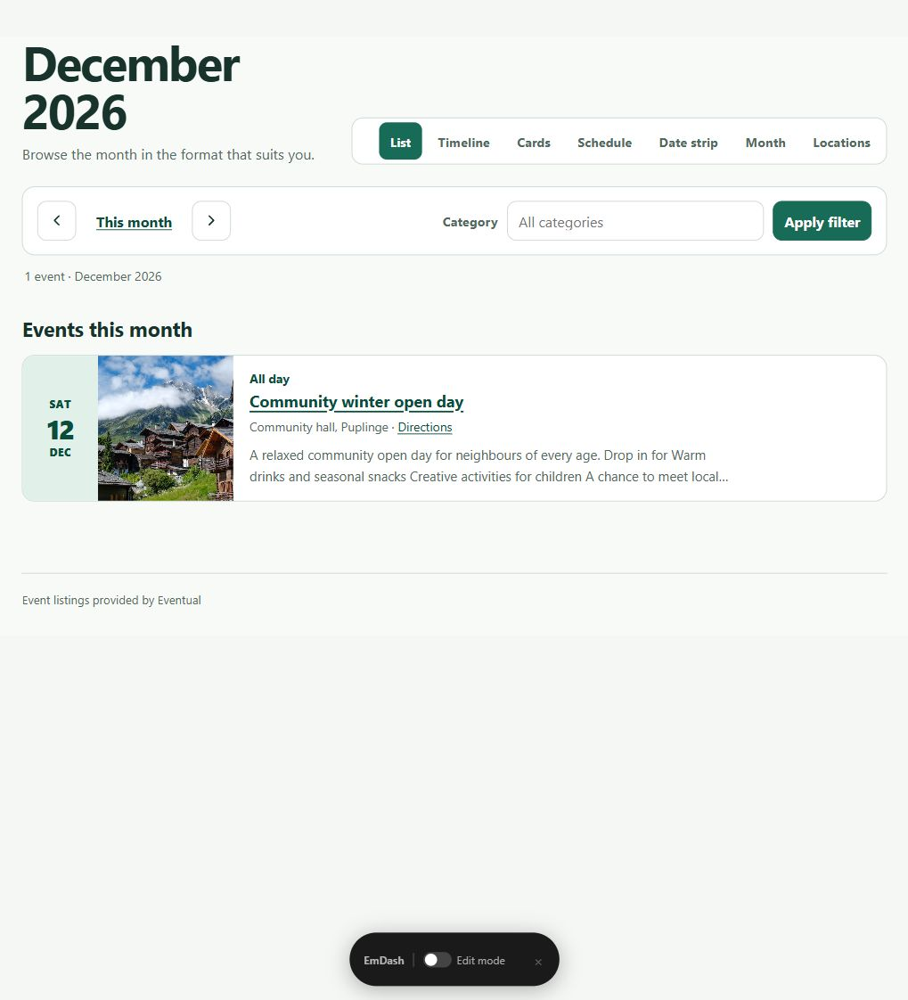
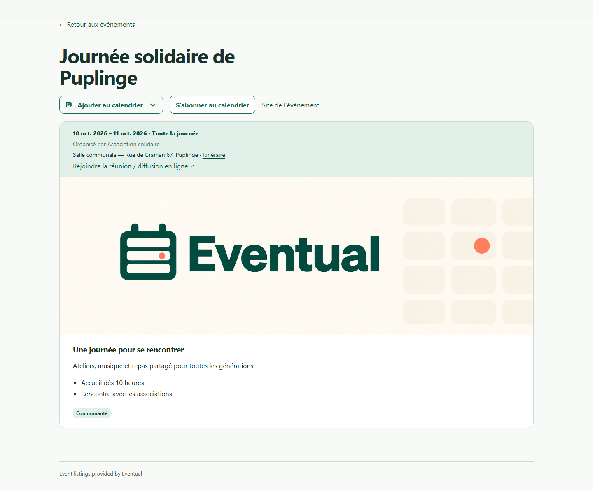
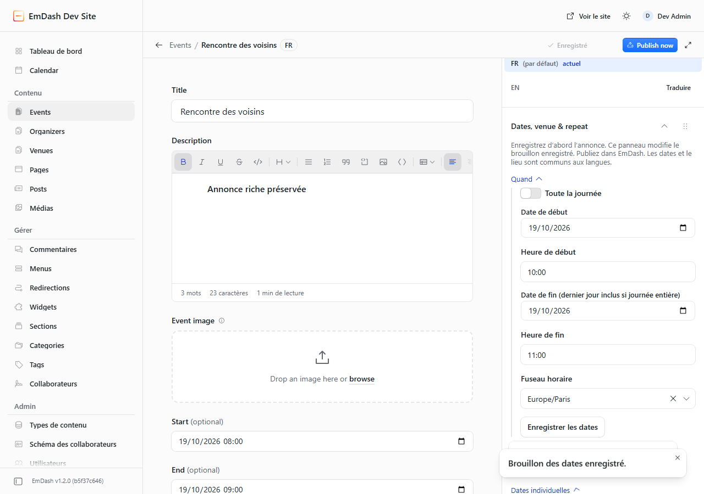

<p align="center">
  
</p>

# Eventual

<p align="center">
  <a href="https://github.com/Vermeulen-Solutions/eventual-emdash-sandbox/actions/workflows/ci.yml"></a>
  <a href="https://github.com/Vermeulen-Solutions/eventual-emdash-sandbox/releases"></a>
  <a href="https://plugins.emdashcms.com/plugins/@vermeulen.solutions/eventual"></a>
  <a href="https://emdashcms.com"></a>
  <a href="./LICENSE"></a>
  
  
</p>

Plan and publish events in [EmDash CMS](https://emdashcms.com). Write announcements, choose venues and organizers, set repeat schedules, and share events through your website and calendar subscriptions.

**Current Registry release: 0.14.0.** Events are edited in EmDash's own collections, with rich text, images, drafts and translations. Your site builder connects the feeds to visitor pages; the screenshots below show the optional Astro showcase.

In 0.14.0, old events stored inside the plugin are shown only when an administrator explicitly enables **Show old events saved inside the plugin**. Native collections remain authoritative. See [what changed](./docs/release-notes-0.14.0.md).

---

## At a Glance

- **Announcements and images:** use EmDash's normal editor, save drafts, then publish.
- **Flexible schedules:** one-off, daily, weekly or monthly events, with changes to individual dates.
- **Saved venues and organizers:** choose existing entries instead of retyping them.
- **Languages:** separate announcements per language, with shared published schedules.
- **Calendars:** event downloads and iCalendar subscriptions.
- **Website integration:** JSON feeds, optional Astro helpers and seven example layouts.
- **Sandboxed:** declared permissions and no outbound HTTP hosts.

## Get Started

1. An administrator [installs Eventual and connects the collections](./docs/collection-setup.md).
2. Editors follow [Managing events](./docs/user-guide.md): save an announcement, open **Dates, venue & repeat**, then publish.
3. Site builders use the [developer guide](./docs/native-modernization.md) to connect visitor pages.

Requires **EmDash >=1.2.0 <2.0.0**; tested on 1.2.0. Upgrades from 0.12.x or earlier need the [native-content upgrade](./docs/upgrade-0.13.0.md). Source/developer tooling needs Node 24+.

---

## Visual Tour

### 1. Website Calendar
Render public events on your site using the included Astro showcase with seven responsive layouts, month navigation, and category filtering—with zero client-side JavaScript.

<p align="center">
  
</p>

---

### 2. Event Details & One-Click Calendar Sync
Visitors can view full event details, join virtual meetings, get venue directions, and add events to Google Calendar, Outlook, Yahoo, or Apple Calendar.

<p align="center">
  
</p>

---

### 3. Native Event Editor
Write announcements in EmDash's rich-text editor. Save the draft, then open Dates, venue & repeat for local dates, recurrence and individual-date changes. The Eventual workspace links to the selected content types and offers safe draft duplication.

<p align="center">
  
</p>

---

### 4. Saved Organizers & Venues
Maintain a directory of organizers (names, websites, contact links) and physical venues with structured addresses and map directions.

Venue choices combine translation siblings into one selection, show the name and address, and retain the saved native ID. The schedule panel searches native names and addresses, including accents. Unpublished dependencies are marked and must be published before their events. Create and edit links open the native venue editor.

---

## Optional Website Views

Visitors can switch between seven viewing formats via query parameter (e.g., `/events?view=month`):

| View | Query Param | Description |
| :--- | :--- | :--- |
| **List** *(Default)* | `?view=list` | Chronological agenda list with high-contrast date blocks. |
| **Timeline** | `?view=timeline` | Vertical timeline with visual event nodes and summary cards. |
| **Card Grid** | `?view=cards` | Rich card grid displaying event cover images, organizers, and tags. |
| **Daily Schedule** | `?view=schedule` | Collapsible daily disclosures grouping events per date. |
| **Date Strip** | `?view=dates` | Horizontal date jump bar for quick navigation across the month. |
| **Month Calendar** | `?view=month` | Full week-aligned calendar grid on desktop; day-by-day agenda on mobile. |
| **Locations** | `?view=locations` | Events grouped by physical venue or virtual attendance with map directions. |

---

## For Developers

Eventual's Registry package supplies the sandbox backend and editor controls. Optional Astro, schema and transfer helpers use the repository's source package. GitHub download versions and Registry releases are listed separately; the badges above identify each.

Use the **actual installed plugin ID** in API URLs and MCP tool names. Config-managed sites normally use `eventual`; Registry sites get a generated ID. The `fetchPublicFeed` helper and showcase currently assume `eventual`, so Registry sites need an adapter to their installed route.

The [developer guide](./docs/native-modernization.md) covers public JSON/ICS/image routes, SSR dispatch, tool names, settings, transfer formats, permissions and sandbox limits. It also explains building matching 0.14.0 source helpers. Eventual's MCP tools inspect native data; native edits and publication use EmDash's core tools.

For source changes:

```sh
npm ci
npm run validate
npm run typecheck
npm test
npm run build
npm run bundle
npm run budget
```

The backend shares EmDash's fixed sandbox RPC budget. Large feeds and migrations need host-specific verification; optional public URL lookups can be disabled when your site constructs its own links. [Details and checks](./docs/native-modernization.md#limits-and-checks).

---

## Documentation

- [Managing events](./docs/user-guide.md) — the editor's everyday guide.
- [Install and connect](./docs/collection-setup.md) — administrators and schema setup.
- [Upgrade and migrate](./docs/upgrade-0.13.0.md) — existing sites and old plugin data.
- [Developer guide](./docs/native-modernization.md) — integration and API reference.
- [0.14.0 changes](./docs/release-notes-0.14.0.md) · [Changelog](./CHANGELOG.md).
- [Astro showcase](./examples/astro-events/README.md) — optional visitor pages.
- [Release evidence and older records](./docs/history.md).

---

## License

Eventual is licensed under the [MIT License](./LICENSE).
